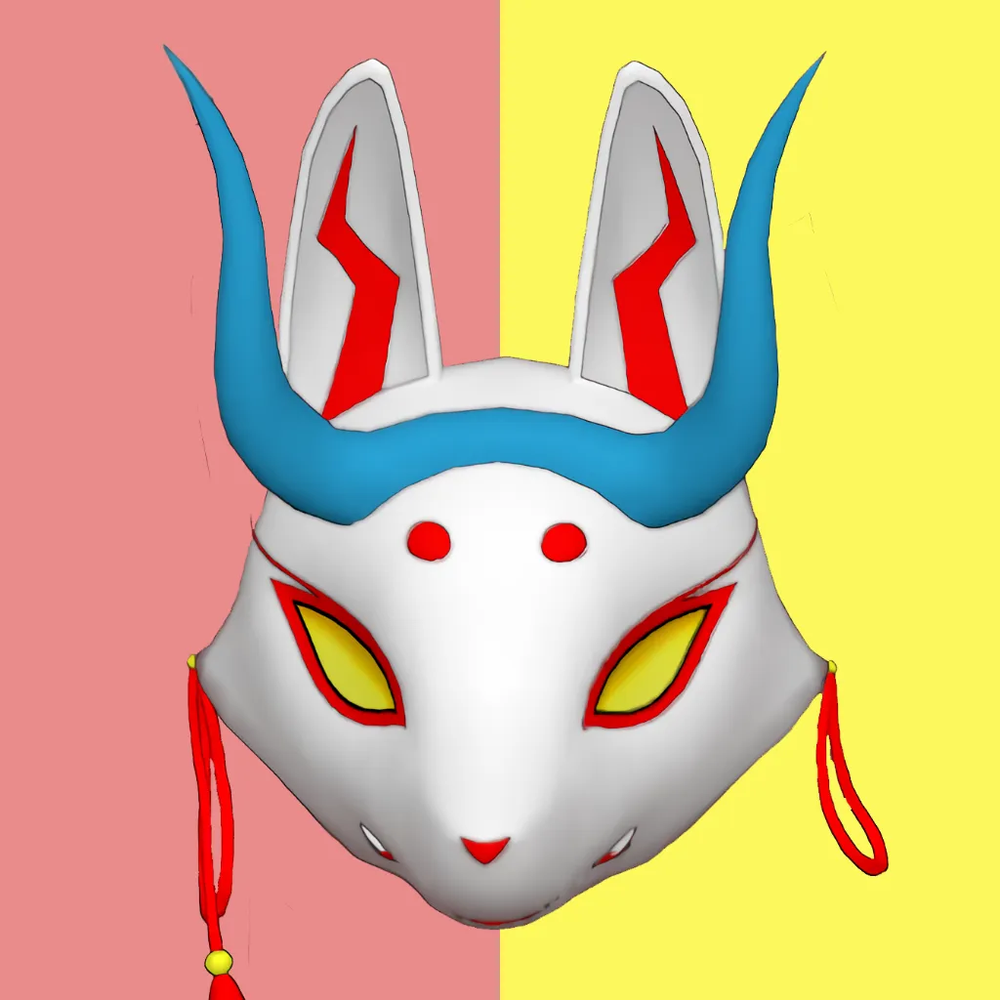

  

  
  &nbsp;&nbsp;
  

  

---

## About Me

Hi I'm Blackwell, I have several aliases you might know me online for. I've spent the past year working on obscure projects and some went great and some weren't. I've recently studied how databases work and now I'm headed over to MCP to understand it. Earlier this year around 2026 I didn't even know how to operate Github but here we are.

---

## Tech Stack

  
  
  
  
  
  
  
  

---

## GitHub Statistics

  
  

  

  

---

## Connect

Website: [ikazune.vercel.app](https://ikazune.vercel.app/)
